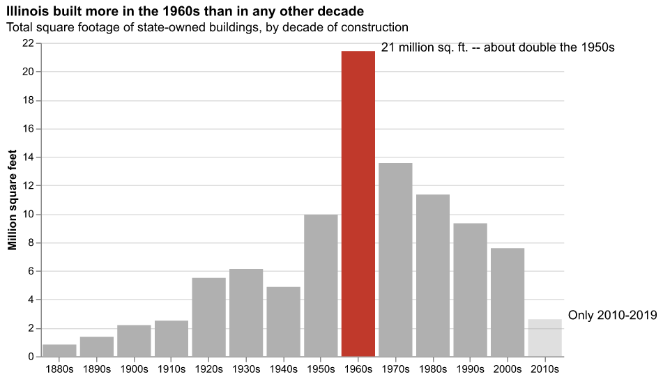
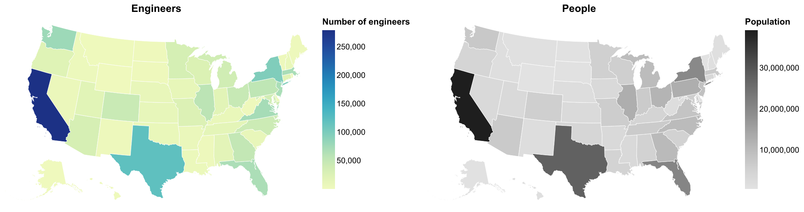
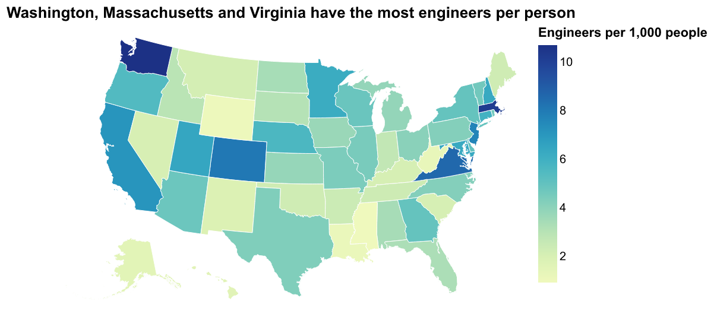
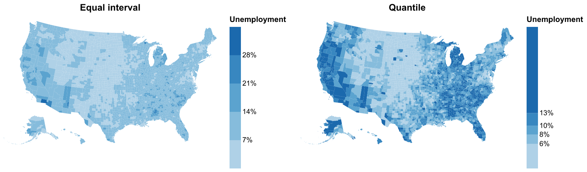

# Storytelling, Maps, SciViz, and Streamlit

---

# Final Project: Where We Are

Three parts, due the last three weeks of class. **Due dates are on Canvas.**

1. **Viz for Self** (individual) -- explore your dataset in a notebook. Mess is fine!
1. **Viz for Peers** (group) -- a dashboard notebook, like Lab #5.
1. **Viz for the Public** (group) -- a Streamlit app, deployed on Streamlit Community Cloud, that somebody who has never seen your data can understand.

For Part 3 you'll also give feedback on three other groups' projects, and your group will submit a video. Presentations are **December 7**.

**Before going further, clear your dataset with me or Yilin.**

---

# Today, and Part 3

Everything today is aimed at Part 3:

- **Storytelling** -- making a chart _say_ something
- **Maps for the public** -- because a lot of you have geographic data
- **Scientific viz** -- what's different about it
- **Streamlit** -- building and deploying the app itself

---

## Classes of Visualization

1. Viz for Self
1. Viz for Colleagues
1. Viz for Others

---

## Viz for Self

We can think of this as telling a story to yourself.

You can take shortcuts -- you can skip labels, colors, and so on, _sort of_. You just have to make sure you're not lying to yourself.


---

## Viz for Self

How do we explore data?

- What characteristic of data influence how you visualize it?
- What information do you have that would be visually interesting?
- What information do you _not_ have that you need in order to understand the importance of the data?

<div class="r-stack">
<p class="fragment fade-in-then-out">Example: A banking database where each record is a bank transaction and the fields include date, deposit or withdrawal amount, customer id, and the interest rate of the account.</p>
<p class="fragment fade-in-then-out">Example: A spreadsheet of experimental crop growth measurements where each record is a measurement, and the fields include date, plant species, plant id number, number of leaves, plant height, number of internodes, and average leaf length.</p>
<p class="fragment fade-in-then-out">Example: A computational simulation of a galaxy where each record is a timestep in the evolution of the 3D grid, and the fields include time, X position, Y position, Z position, gas density, gas temperature, gas metallicity, and number of stars.</p>
</div>

---

## Viz for Self

What do you want to get out of visualization for yourself?

- Do you want to find meaning?
- Do you want to understand how to guide further visualizations?
- Is the story you want to tell already known to you?
- What **shortcuts** can you take?

---

## Viz for Experts

To design a visualization for experts, you need to analyze how they process information.

- What do they know?
- What conventions will they assume?
- Are they able to fill in the blanks of information?

---

## Viz for Experts

<iframe width="1024" height="576"
src="https://www.youtube.com/embed/FG1NNH7Kmok?rel=0" frameborder="0"
allow="encrypted-media" allowfullscreen></iframe>

notes:
This is from Chris Havlin, and it's vorticity of a tornado

---

## Viz for Experts


notes:
Here's a series of visualizations made by or for domain experts that I just had lying around on my laptop.

What are some things you notice they have in common?

---

## Viz for Experts


notes:
Here's a series of visualizations made by or for domain experts that I just had lying around on my laptop.

What are some things you notice they have in common?

---

## Viz for Experts


notes:
Here's a series of visualizations made by or for domain experts that I just had lying around on my laptop.

What are some things you notice they have in common?

---

## Viz for Experts

Experts often want to interrogate the data themselves.

How can they do that?

- Linked Dashboards
- Side-by-side comparison plots
- Text annotation with specific values listed
- Color bar annotation

notes:
ask students - other ideas? what about interactivity? (Interactivity needs to be decent)

---

## Viz for Experts

Experts are looking to isolate variables to make scientific conclusions.

How can we make visualizations more analytical?

- Reduce the dimensionality of the image (slices)
- Viewpoint from "outside the box"
- Extremely high contrast color choices (or highlight different features)

notes:
ask students - other ideas? What about animated data?

---

## Viz for the Public

This is what you're most accustomed to, because usually YOU are the public.

Communicating information to the public is an entire field, and I encourage you to take IS457 - Data Storytelling for a more comprehensive discussion.

---

## Storytelling and Annotation

So what makes a viz for the public _work_? A lot of it comes down to one thing:

**Tell people what you want them to see.**

You've spent hours with your data. Your reader has spent about eight seconds. They don't know what's interesting yet -- that's your job.

(This is also the FDV chapter on [telling a story](https://clauswilke.com/dataviz/telling-a-story.html) from last week's reading.)

---

## Title as a Sentence

The single most effective thing you can do:

- "Square footage by decade" tells me what the axes are.
- "Illinois built more in the 1960s than in any other decade" tells me what to look for.

Put the takeaway in the title. Put the description of the axes in the subtitle.

```python
title = alt.Title(
    "Illinois built more in the 1960s than in any other decade",
    subtitle="Total square footage of state-owned buildings, by decade",
    anchor="start",
)
alt.Chart(df, title=title).mark_bar()...
```

---

## Highlight, Then Gray Out

Use color to _point_ at something, not just to decorate.

```python
color = alt.condition(alt.datum.Decade == 1960,
                      alt.value("#c0392b"), alt.value("#b0b0b0"))
```

Everything that isn't the story goes gray.

And: don't make color the _only_ way to find the thing. Here, it's also the tallest bar, and it's also got a label on it. (About 1 in 12 men has some form of color vision deficiency. Remember week 3!)

---

## Annotate Directly

Put the words right next to the thing they're about. No legends to decode, no "see figure caption."

In Altair, annotations are just another layer:

```python
notes = pd.DataFrame([
    {"Decade": 1960, "million_sqft": 21.4,
     "note": "21 million sq. ft. -- about double the 1950s"},
])
annotations = alt.Chart(notes).mark_text(align="left", dx=22).encode(
    x="Decade:O", y="million_sqft:Q", text="note:N")

bars + annotations
```

---

## Be Honest About the Caveats



That 2010s bar looks like a collapse! But the data stops in 2019. So we fade it out _and_ label it.

Annotations aren't just for the exciting part -- they're also for the part that might mislead.

note:
also -- always have a source line.  st.caption in streamlit, or just text underneath.

---

## Structure: Martini Glass

A lot of good public-facing viz follows the "martini glass" shape:

1. **The stem:** you lead. Here is the thing, here is why it matters, here is what to notice.
2. **The bowl:** then you let go. Here are the controls, go explore.

Your final project is a great place for this! Start with a few annotated, opinionated charts, _then_ hand them the interactive dashboard.

---

## Example: Storytelling and Annotation

`storytelling_annotation.ipynb` walks through all of this, step by step, starting with the "viz for self" version and ending with something you'd publish.

It also ends with a sneak preview of something we'll spend a lot more time on in a couple of weeks: making sure the chart works for people who can't _see_ it.

---

## Maps for the Public

We learned how to _make_ maps in weeks 7-9. Now: how to make maps that don't mislead people.

Maps are one of the most popular things you can show the public. Everybody wants to find their house! They're also one of the easiest things to get wrong, in ways that look totally fine.

---

## Every Raw-Count Map Is a Population Map



Where are the engineers? California, Texas, New York... which is to say, where the people are. ([xkcd #1138](https://xkcd.com/1138/))

---

## Divide by Something



Engineers _per 1,000 people_: a different story. Texas drops to the middle, Florida to the bottom half.

If your number goes up just because more people live there, you want a **rate**. And say what you divided by, in the legend!

---

## Classes Are a Choice



Same data. **Equal interval** splits the _range_ into equal chunks. **Quantile** puts the same _number of counties_ in each class -- look how narrow its classes are.

Which one is the "unemployment crisis" map?

note:
quantile always uses every color equally, so it always looks dramatic.  equal interval gets dominated by a few outliers.  neither is wrong; make the choice on purpose and show the breaks in the legend.

---

## Big, Empty States

On a map, size means _land area_. That's almost never what your data is about.

Wyoming gets about 11 times the ink of New Jersey, with about a fifteenth of the people.

If the question is "which is highest?", a **sorted bar chart** is usually better. Every state gets the same space. Show both: the map for "where," the bars for "how much."

---

## Sequential or Diverging?

- **Sequential** (light to dark): low to high, nothing special in the middle. This is the default.
- **Diverging** (two hues, light in the middle): _only_ when the middle means something -- zero, an average, a target.

A diverging scheme on data with no real midpoint invents a "good side" and a "bad side."

And: missing data should look different from zero. Not the lightest color in your scheme!

---

## What Does a Map Sound Like?

We gave our map to maidr. Pressing the right arrow:

> id is 2, Engineers per 1,000 people is 1.59

"id is 2" is Alaska's FIPS code. The state's name never gets read.

So the accessible version of a map is _everything around it_:

1. **A sentence** that says the point, generated from the data
2. **A sorted bar chart** -- maidr reads "state is Washington, Engineers per 1,000 people is 10.71"
3. **A table**, so people can find their own state

---

## Example: Maps for the Public

`maps_for_the_public.ipynb`:

- raw counts vs. rates
- continuous, equal interval and quantile classes, side by side
- the sorted bar chart alternative
- a diverging scheme with a real midpoint
- what maidr does with a map, and what to do about it

If you have geographic data for your project, go through the checklist at the end.

---

## Scientific Visualization

What characterizes "scientific" visualization?

- Spatial organization - distance metrics
- Dimensionality reduction or mapping
- Multiple overlapping quantities with implicit or explicit extent

---

## Scientific Visualization - Data Representations

<div class="multiCol">
<div class="col">
<div class="fig-container" data-style="height: 600px;" data-file="figures/blank_axes.html" data-markdown=true>
</div>
</div>
<div class="col" data-markdown=true>

Commonly, data will be represented in "scientific visualization" through one of a few mechanisms:

- Discrete points
- Volume-filling information
- Meshed values

</div>
</div>

---

## Discrete Points: Data

<div class="multiCol">
<div class="col">
<div class="fig-container" data-style="height: 600px;" data-file="figures/scatter.html" data-markdown=true>
</div>
</div>
<div class="col" data-markdown=true>

- Associated field values
- May have extent
- Values can be either
  - Locally defined
  - Integrated over neighbors

</div>
</div>

---

## Discrete Points: Density Estimates

- Searching
  - Quadtree
  - kD-tree
- Integration
  - Kernels
  - Nearest-neighbor

---

## Discrete Points: Techniques

<div class="multiCol">
<div class="col">
<div class="fig-container" data-style="height: 600px;" data-file="figures/discrete_tech.html" data-markdown=true>
</div>
</div>
<div class="col" data-markdown=true>

- Associated field values
- May have extent
- Values can be either
  - Locally defined
  - Integrated over neighbors

</div>
</div>

---

## Volume data: strategies

To analyze volume data, typically we conduct one or more of these operations:

- Select data based on spatial or non-spatial criteria
- Reduce the dimensionality of that data either along spatial or other axes
- Aggregate data

This can include operations such as volume rendering, axial projection, histogramming/binning and resampling.

---

## Big-ish Data

How do we deal with data that is too large to fit into memory?

- Can we cycle our operations?
- Can we use tools to cycle operations?

---

## Operations

Some operations we can manually cycle through, storing only reductions in memory rather than the full dataset.

Clear candidates:

- Mean
- Extrema
- Histograms and "binning"

Is this the same as incremental updates to a dataset?

(What about the median?)

---

## Streamlit, Continued

Last week we got a quick taste of [Streamlit](https://streamlit.io/). Today we're going to dig in a little more, because this is what you'll be building Part Three of your final project in.

We'll go through three examples, and then we'll deploy one.

All of the examples live in the `week12/streamlit/` directory of the course repo.

---

## Running the Examples

If you've got the course repo checked out:

```bash
uv sync --extra notebooks
uv run streamlit run week12/streamlit/01_hello_streamlit.py
```

Otherwise, `pip install streamlit altair pandas requests` and then:

```bash
streamlit run 01_hello_streamlit.py
```

This will pop open a browser tab. Leave it open! When you save changes to the file, Streamlit will notice and offer to re-run it.

---

## The Streamlit Mental Model

This is the one thing to really internalize:

**Every time somebody touches a widget, Streamlit re-runs your _entire script_, top to bottom.**

```python
import streamlit as st

n = st.slider("How many?", 1, 100, 10)
st.write(f"You picked {n}")
```

`st.slider` just returns a number. No callbacks, no `.observe()`, no linking traitlets together.

note:
compare this with what we did with bqplot -- there we built the figure once and then wired up observers to change it.  Here we just rebuild everything, every time.  This is wasteful!  But it's also *really* easy to reason about.

---

## Example 1: Hello, Streamlit

`01_hello_streamlit.py`

- `st.write`, the "do what I mean" function
- sliders, checkboxes and buttons
- the quick built-in charts (`st.line_chart`, `st.bar_chart`)
- `st.sidebar` and `st.columns` for layout
- `st.session_state` for things that need to survive a re-run

note:
the button counter is the one to really look at -- if you use a regular variable it resets every time the script re-runs.  session_state is where things go that you want to keep around.

---

## Caching

Since the whole script re-runs every time, we really don't want to re-load our data every time.

```python
@st.cache_data
def load_data():
    return pd.read_csv("building_inventory.csv")
```

The first time, it actually runs. Every time after that, Streamlit hands you back the same result.

You can also give it a `ttl` -- "time to live" -- so that it expires:

```python
@st.cache_data(ttl=300)  # 5 minutes
def load_quakes():
    ...
```

---

## Example 2: Building Inventory (Again!)

`02_building_inventory.py`

Our old friend. This is basically the bqplot dashboard we built, but in Streamlit:

- controls in the sidebar
- an Altair (vega-lite!) scatter plot with an interval selection
- a bar chart and a table that react to that selection

---

## Linking and Brushing in Streamlit

Altair charts are vega-lite under the hood, so we can add selections like we did before. The new part is getting the selection _back into Python_:

```python
brush = alt.selection_interval(name="brush", encodings=["x"])
chart = alt.Chart(df).mark_circle().encode(...).add_params(brush)

event = st.altair_chart(chart, on_select="rerun")
event.selection["brush"]  # {'Year Constructed': [1950.2, 1971.8]}
```

`on_select="rerun"` means: when the selection changes, re-run the script and tell me what got selected.

note:
this is the same interval selection we wrote by hand in the vega-lite JSON a few weeks ago.  Now we just get to use it from Python.

---

## Example 3: Live Earthquakes

`03_live_earthquakes.py`

What if your data keeps changing? This one pulls the [USGS earthquake feed](https://earthquake.usgs.gov/earthquakes/feed/v1.0/geojson.php), which updates every minute or so.

- GeoJSON into a dataframe (we've seen this before)
- `st.map` for a quick-and-dirty map
- a histogram and a scatter in Altair
- **checking for new data**

Your project does _not_ need live data! But if yours comes from an API that updates, here's how.

---

## Checking for New Data

Two ways to do it. A button that clears the cache:

```python
if st.button("Check for new data"):
    load_quakes.clear()
```

Or, a _fragment_ that re-runs itself on a timer:

```python
@st.fragment(run_every="60s")
def live_quakes():
    ...
```

A fragment re-runs _just that function_, not the whole script. This is the Streamlit version of what we did last week with vega-lite changesets.

If you do have changing data, a button is totally fine.

---

## Deploying: Streamlit Community Cloud

[Streamlit Community Cloud](https://streamlit.io/cloud) is free, and it deploys right out of a GitHub repo.

1. Put your app in a **public** GitHub repo.
2. Add a `requirements.txt` listing every package you import (see `week12/streamlit/requirements.txt`).
3. Go to [share.streamlit.io](https://share.streamlit.io) and sign in with GitHub.
4. "Create app," then pick your repo, branch and the path to your `.py` file.
5. You get a `something.streamlit.app` URL. That's what you submit!

Every time you push to that branch, it'll redeploy.

note:
the #1 thing that goes wrong here is a missing package in requirements.txt.  If it works on your machine and not on the cloud, check that first.

---

## Deploying: Some Gotchas

- **requirements.txt.** If you `import` it, it needs to be in there.
- **Data files.** Paths are relative to the root of your repo, not to wherever you happened to run it. Keep data files small (remember GitHub's size limits!) or load them from a URL.
- **Secrets.** Do _not_ commit API keys. Use `st.secrets` and the "Secrets" setting in the app dashboard.
- **Sleeping.** Apps that nobody visits for a while go to sleep, and take a little bit to wake back up. Load yours up before you present it!

---

## Try It

Take the dataset you're using for Part One, and:

1. Make a Streamlit app that loads it (with caching!)
2. Add at least one widget that changes what's shown
3. If you're feeling ambitious, deploy it

This doesn't have to be pretty. This is viz for self!

---

## Group Time

The rest of today is yours.

- Find your group, if you haven't yet (sign-up deadline is on Canvas!)
- Talk through your Part One datasets -- which one(s) will you use for Parts Two and Three?
- **Come clear your dataset with me or Yilin before you leave.**
