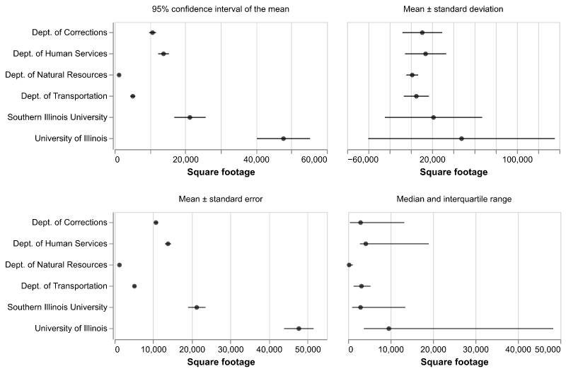
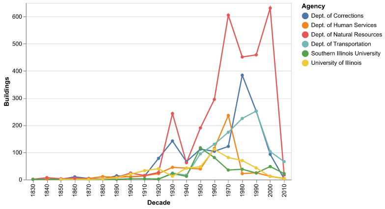
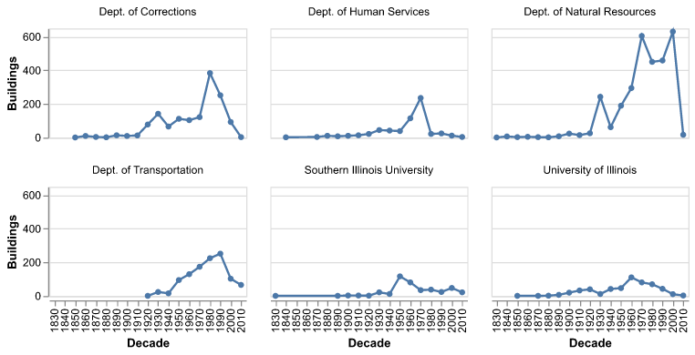

## Validation

How do you know your visualization is actually useful? Is it...

- More comprehensive or contextual
- More revealing or educational
- More fun or pleasant to use
- More efficient or fast

notes:
What do we even mean "more than"? More than what?

More than just looking at numbers?

More than a previous visualization?

More than the state of the art?

---

## Validation

Why is validating a visualization important?

1.  The design space is huge
1.  Most designs are ineffective
1.  User-focused design is often an afterthought
1.  The "quality" of a visualization is subjective

notes:
Can you all think of a user experience that drives you nuts in your daily life? A pointless button in your email? A door that opens the wrong way? A noisy piece of machinery?

---

## Validation

What can a visualization designer get wrong?

- Misunderstand the needs of the domain expert or educator
- Interpret the data incorrectly
- Represent the data in a visually confusing way
- The software is too laggy or difficult to use in a practical setting

notes:
Any other ideas?

---

## Methods of Validation

Before developing your visualization system:

1.  Observe and interview target users or audience members
1.  Justify interaction design plans against the academic literature and existing tools
1.  Do an analysis of the complexity of the system

---

## Methods of Validation

After developing your visualization prototype:

1.  Measure system performance
1.  Usability studies (formal and/or informal)
1.  Measure human time to complete a task, or number of user errors
1.  Do a field study - perhaps even collect user data with the system

notes:
You don't have to do all of these all the time, but depending on the project they might all be a good idea

Also, remember to respect user privacy when collecting user data. This is extremely sensitive.

---

## Methods of Validation

After publishing your visualization:

1.  Observe adoption rates
1.  Solicit anecdotal user feedback

notes:
This is especially valuable if you expect to have to make more than one visualization in your life. Building intuition for what works and what doesn't is a large part of the career success of a visualization designer.

The Advanced Visualization Lab interacts with audiences through lab demos and conference talks regularly to collect this kind of feedback.

**we'll be getting a talk from the head of the AVL in week 13**

---

## Example informal Validation: AVL


notes: here is an example of an informal validataion that the AVL does a lot of.

Here the data visualizers are doing a showing of their movie and asking audiences for feedback - both on what they liked and didn't like, but also on what they learned.

---

## Validation in Final Project

Your peers will ask you questions in the Open Discussion Forum.

Try to understand what is working for them and what is not. It will help hone your instincts.

---

## Validation Includes Everybody

When you ask "does this work?" -- work for _who_?

If you only ever test your viz by looking at it, you're only validating it for people who can see it the way you do.

Some quick checks you can do yourself, today:

- Can you get the main point with the color turned off? (Grayscale it!)
- Can you get to everything with just the keyboard? (Unplug your mouse.)
- What does a screen reader say about it? (VoiceOver: Cmd + F5 on a Mac. NVDA is free on Windows.)

We'll go _much_ deeper on accessibility on November 30. For now, keep it in the back of your head as we go.

---

## Final Project Check-in

- Groups should be set. If you're not in one, come talk to me after class!
- **Part Three is a Streamlit app, deployed on [Streamlit Community Cloud](https://streamlit.io/cloud).** See last week's slides and the `week12/streamlit/` examples.
- Presentations are on **December 7**, our last class -- five minutes per group.
- Due dates for each part are on Canvas.

---

# Uncertainty

---

## Your Numbers Are Never Exact

Pretty much every number you plot has some uncertainty in it:

- It's a sample (a survey, a poll, a subset)
- It's a summary (a mean hides a whole distribution)
- It's a measurement (instruments have error)
- It's a prediction (weather, elections, models)

If you don't show it, people will assume your numbers are exact. And they'll read differences into noise.

note:
reading for this: FDV ch 16, visualizing uncertainty -- https://clauswilke.com/dataviz/visualizing-uncertainty.html

---

## "Error Bars" Can Mean Four Different Things



Same data, four different intervals. Two are about how sure we are of the _average_; two are about how spread out the _data_ is.

**Always say what your error bars are.**

note:
also note the mean +/- sd one goes negative -- negative square feet!  that's a hint that mean/sd is the wrong summary for this data.

---

## Other Ways to Show Uncertainty

- **Show the distribution** -- box plots, violins, strips of points. Let people see the spread.
- **Gradients and bands** -- fade the interval out instead of a hard edge.
- **Hypothetical outcome plots** -- animate through plausible outcomes. People are better at "how often" than "what's a 95% interval."
- **Words** -- "between 12,000 and 15,000 square feet." Seriously! Especially for the public.

---

## Uncertainty and Accessibility

Here's something we found out building this week's notebook. With [maidr](https://py.maidr.ai/):

- A seaborn **point plot** with confidence intervals gets read as an _error bar_ chart. You can hear the interval for each item.
- A seaborn **bar plot** with confidence intervals gets read as... a bar chart. The error bars are just gone, and nothing tells you they're missing.

Tools quietly drop things. **Check.** And put the uncertainty in words, too.

---

# Small Multiples

---

## The Spaghetti Problem



Six colors, lines crossing everywhere, and you're bouncing back and forth to the legend. (And six colors is already pushing it for color vision deficiencies.)

---

## Small Multiples



One little chart per group, same scale, same position. Your eye compares _shapes_, no decoding required.

```python
alt.Chart(df).mark_line().encode(x="Decade:O", y="Buildings:Q").properties(
    width=180, height=100
).facet(facet="Agency:N", columns=3)
```

---

## Shared or Independent Scales?

```python
.resolve_scale(y="independent")
```

- **Shared:** you can compare across panels. (Natural Resources built way more buildings than U of I.)
- **Independent:** you can see each panel's shape. But now comparing across panels is misleading!

Neither is wrong. Make the choice on purpose -- and say which one you made.

---

## Small Multiples and Accessibility

maidr can't read a faceted Altair chart at all -- it raises an error.

But the same small multiples built with matplotlib `subplots` get read as six separate line plots, which you can move between.

So, sometimes, the accessible choice is also a _library_ choice.

---

## Example: Uncertainty and Small Multiples

`uncertainty_small_multiples.ipynb` -- building inventory, one more time:

- bar chart of means, then means with confidence intervals
- four kinds of error bars, computed by hand
- box plots
- spaghetti to small multiples, shared and independent scales
- what survives in maidr, and what doesn't

Bonus lesson in there: putting several vega-lite `errorbar` charts on the same data into one `hconcat` currently computes the _wrong_ intervals, silently. Check your charts against numbers you computed yourself!

---

## After the Break: Build Your Observatory

After the break, we build. Every group starts from a Streamlit template, and leaves today with a deployed app.

While you're on break:

- Make sure somebody in your group has a GitHub account
- Pull up your group's dataset (or API!)
- Start thinking about your one-sentence story
