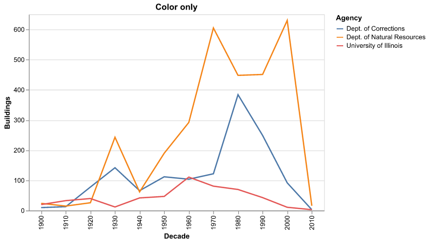
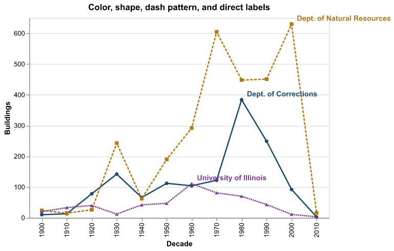

# Accessible Visualization

All semester, we've been making charts that you have to _see_ to use.

Today, we're going to fix that. At least a little.

---

## Who Are We Leaving Out?

- **Blind and low-vision readers**, who might use a screen reader, magnification, or a braille display
- **Color vision deficiencies** -- about 1 in 12 men, and about 1 in 200 women
- **Motor disabilities** -- people who can't use a mouse, and use a keyboard or a switch instead
- **Cognitive disabilities** -- people for whom a dense, jargon-heavy chart is a wall
- **Everybody, sometimes** -- reading on a phone in the sun, a washed-out projector, a broken trackpad

note:
the last one is the one people forget.  accessibility helps everybody.  have you ever tried to read a chart on the projector in this room?

---

## This Is Also the Law

A 2024 Department of Justice rule under the ADA requires public universities' web content -- including course materials -- to meet [WCAG 2.1, Level AA](https://www.w3.org/WAI/WCAG22/quickref/). For large public entities like the University of Illinois, the compliance date is **April 26, 2027**. ([ADA.gov fact sheet](https://www.ada.gov/resources/2024-03-08-web-rule/))

So: if you go on to make dashboards for a state agency, a city, a public university or a public hospital, this is going to be part of your job.

But mostly, it's just the right thing to do.

---

## WCAG in One Slide

The Web Content Accessibility Guidelines are organized around four principles, "POUR":

- **Perceivable** -- can people sense it? (contrast, color, text alternatives)
- **Operable** -- can people use it? (keyboard, enough time, nothing flashing)
- **Understandable** -- can people make sense of it? (clear language, predictable behavior)
- **Robust** -- does it work with assistive technology? (screen readers, braille displays)

For charts specifically, check out [Chartability](https://chartability.fizz.studio/), a set of heuristics for auditing data visualizations built on top of these.

---

## Example: Accessible Visualization

`accessible_viz.ipynb` walks through everything today:

1. Color and contrast
2. Text alternatives
3. Exploring without seeing: maidr
4. Putting it in your Streamlit app

Open it up and follow along!

---

# Color and Contrast

---

## How Much Contrast?

WCAG gives us actual numbers. Contrast is a ratio from 1:1 (identical) to 21:1 (black on white).

- **Text:** at least **4.5:1** (3:1 for large text)
- **Graphical objects** you need to understand the chart -- bars, lines, points: at least **[3:1](https://www.w3.org/WAI/WCAG22/Understanding/non-text-contrast.html)**

You can check with [WebAIM's contrast checker](https://webaim.org/resources/contrastchecker/), or compute it yourself -- the notebook has a ten-line `contrast_ratio` function. It's not magic!

---

## Altair's Default Colors

Half of the default categorical palette fails 3:1 against white. Here are a few (the notebook has all ten):

| Color | Contrast vs. white |
| --- | --- |
| <span style="color:#4c78a8">■</span> `#4c78a8` | 4.61 ✓ |
| <span style="color:#f58518">■</span> `#f58518` | 2.55 ✗ |
| <span style="color:#72b7b2">■</span> `#72b7b2` | 2.30 ✗ |
| <span style="color:#eeca3b">■</span> `#eeca3b` | 1.60 ✗ |
| <span style="color:#ff9da6">■</span> `#ff9da6` | 1.98 ✗ |
| <span style="color:#bab0ac">■</span> `#bab0ac` | 2.12 ✗ |

That yellow line on a white background? A lot of people just won't see it.

note:
this doesn't mean never use light colors.  it means don't make anything *important* depend on them.

---

## Don't Rely on Color Alone



If color is the _only_ way to tell these apart, some of your readers can't tell them apart. ([WCAG 1.4.1](https://www.w3.org/WAI/WCAG22/Understanding/use-of-color.html))

---

## Redundant Encoding



Color _and_ shape _and_ dash pattern _and_ a direct label. No legend needed.

Quick test: take a screenshot and make it grayscale. Can you still read it?

---

# Text Alternatives

---

## Alt Text

A screen reader user gets whatever text you give them. If you give them nothing, they get "image." Or a file name.

A good pattern, from Amy Cesal's ["Writing Alt Text for Data Visualization"](https://medium.com/nightingale/writing-alt-text-for-data-visualization-2a218ef43f81):

> _[Chart type] of [type of data] where [reason for including the chart]._

> _Line chart of buildings constructed per decade for three Illinois agencies, where Natural Resources builds far more than the other two, peaking in the 1970s and again in the 2000s._

Short. Says the point. Remember the "title as a sentence" idea from week 12? Same idea!

---

## Alt Text in Our Tools

**Markdown / HTML:**

```markdown

```

**Vega-lite / Altair** -- `description` becomes the chart's `aria-label`:

```python
chart.properties(description="Line chart of buildings constructed per decade, where ...")
```

**Streamlit** -- put the takeaway in text right above the chart, with `st.markdown` or `st.caption`. Everybody reads it, and it works with every chart.

---

## Give Them the Data

Sometimes the best text alternative is just... the table.

It's not glamorous, but screen readers handle tables really well, and some sighted readers want the exact numbers anyway.

```python
with st.expander("Data table"):
    st.dataframe(df)
```

---

# Exploring Without Seeing

---

## Alt Text Isn't Enough

Alt text gets you _my_ takeaway.

But what if you want to explore the chart yourself? Find the peak, compare two bars, follow a trend, notice the thing I didn't think to mention?

Sighted readers get to do that. Screen reader users usually don't.

---

## maidr

[maidr](https://py.maidr.ai/) -- Multimodal Access and Interactive Data Representation -- comes from the [xability lab](https://xability.github.io/), right here in the iSchool.

It takes a regular matplotlib, seaborn or Altair chart and makes it explorable four ways:

- **Keyboard:** arrow keys move from data point to data point
- **Text:** each point is read out
- **Sound:** pitch follows the value -- you can _hear_ a trend
- **Braille:** on a refreshable braille display

```bash
pip install maidr
```

(In the course repo: `uv sync --extra notebooks` -- it's already in there.)

---

## maidr Keyboard Controls

Click on the chart, or Tab to it. Then:

| Key | Does |
| --- | --- |
| Arrow keys | Move between data points |
| **T** | Text descriptions on/off |
| **S** | Sound (sonification) on/off |
| **B** | Braille on/off |
| **R** | Review mode -- read the current text with your screen reader |
| **Ctrl + /** (Cmd + / on a Mac) | Show every shortcut |

The full list is in the [maidr controls documentation](https://maidr.ai/docs/CONTROLS.html).

---

## maidr in Code

It's (almost) no extra work:

```python
import maidr
import matplotlib.pyplot as plt
import seaborn as sns

fig, ax = plt.subplots()
sns.barplot(data=df, x="Agency", y="Buildings", ax=ax)
maidr.show(fig)
```

Altair works the same way: `maidr.show(chart)`.

Want to share it? `maidr.save_html(fig, "chart.html")` writes a standalone page.

note:
importing maidr also switches matplotlib's backend, so plt.show() gives you accessible output too.  maidr.set_backend(use_maidr=False) undoes that.

---

## Try It: Eyes Closed

In the notebook, there's a bar chart of buildings by agency.

1. Close your eyes. (Or have your neighbor cover the screen.)
2. Click into the chart, turn on text (**T**) and sound (**S**).
3. Find the agency with the most buildings.

Then try the line chart: turn on sound and just hold down the right arrow.

note:
give this a good five minutes.  it's genuinely a different experience, and it's the whole point of today.

---

## What maidr Can (and Can't Yet) Do

It handles a lot: bar, line, scatter, histogram, box plot, heatmap, error bars, and more, from matplotlib, seaborn and Altair.

But remember what we found in week 13:

- A seaborn **bar plot with confidence intervals** is read as plain bars. The error bars are silently dropped.
- A **point plot** with the same intervals is read as an error bar chart.
- **Faceted or concatenated Altair charts** aren't supported at all. matplotlib `subplots` are.
- **Time axes are read as raw numbers.** A regular `time:T` axis is announced as "time is 1,793,952,000,000." Use a text label like "Tue 3 PM" on an ordinal axis instead. (See `week13/streamlit/observatory_template.py`.)
- maidr reads your **axis titles** aloud. `temperature_2m` is not a title!

Tools quietly drop things. **Always check.**

---

# Screen Readers

---

## Try a Screen Reader

You don't really know if something is accessible until you've tried it.

- **Mac:** VoiceOver is built in. **Cmd + F5** turns it on and off.
- **Windows:** [NVDA](https://www.nvaccess.org/) is free.
- **Phones:** VoiceOver (iOS) and TalkBack (Android) are built in.

Try one on your final project. It is humbling. That's okay!

note:
the first time is disorienting -- go slow, and give yourself a few minutes to get the basics.  vo+right arrow moves forward on a mac.

---

## Keyboard and Interactivity

Everything you can do with a mouse, you should be able to do with a keyboard.

Some things we've built this semester that _don't_ pass:

- **Hover tooltips** -- no hover, no information.
- **Brushing to select** (our building inventory app!) -- there's no keyboard way to drag a box. Offer a slider or a dropdown that does the same thing.
- **Clicking on a map** -- same deal.

Test: unplug your mouse and try to use your app.

---

## Motion and Change

- **Auto-updating content** -- if the page changes on its own, a screen reader user can lose their place. WCAG says people need to be able to [pause, stop or hide](https://www.w3.org/WAI/WCAG22/Understanding/pause-stop-hide.html) it.
- **Animations and transitions** (hello, D3!) -- keep them short, and respect the "reduce motion" setting where you can.
- **Nothing that flashes.** Ever.

So: in our observatories, auto-refresh should be **off by default**, and if it's on, say so.

---

# Putting It Together: Streamlit

---

## An Accessible Observatory

`week14/streamlit/accessible_observatory.py` is the week 12 earthquake observatory, redone:

1. Charts go through maidr's `render_maidr`
2. A written summary, generated from the data, comes _first_
3. The data is available as a table
4. Color is never the only encoding
5. Auto-refresh is off by default, and the page says when it's on
6. The map is described in words, and the "where" is in the table

```bash
uv run streamlit run week14/streamlit/accessible_observatory.py
```

Open it next to `week12/streamlit/03_earthquake_observatory.py` and compare.

---

## render_maidr

One line changes:

```python
from maidr.widget.streamlit import render_maidr

# st.altair_chart(chart)
render_maidr(chart)
```

It works with matplotlib, seaborn and Altair charts. And if a fragment re-runs but the chart hasn't changed, the reader keeps their place. (When new data _does_ change the chart, it reloads and they start over -- one more reason auto-refresh should be opt-in.)

(The catch: it doesn't send selections back to Python like `st.altair_chart(..., on_select="rerun")` does. So use sliders and dropdowns for filtering, which is better for keyboard users anyway!)

---

## Write the Summary From the Data

```python
def describe(quakes, window):
    biggest = quakes.loc[quakes["mag"].idxmax()]
    return (
        f"In the {window.lower()}, there were {len(quakes)} earthquakes. "
        f"The largest was magnitude {biggest['mag']:.1f}, {biggest['place']}."
    )

st.markdown(describe(quakes, window))
```

It updates whenever the data does. And honestly? It's often the most useful thing on the page, for _everybody_.

---

## Labels Matter

Every widget's label is what a screen reader announces.

```python
st.slider("Mag", ...)                          # "Mag, slider." Huh?
st.slider("Minimum magnitude to include", ...) # Oh, okay.
```

Same goes for chart titles and axis titles. `mag:Q` is not a title!

---

# Your Turn

---

## Audit Your Final Project

With your group:

1. **Contrast:** check your colors. Anything important under 3:1?
2. **Color alone:** go grayscale. Can you still read it?
3. **Alt text:** one sentence per chart, using the pattern.
4. **Summary:** is the main point in words, somewhere near the top?
5. **Keyboard:** unplug the mouse. Can you use every control?
6. **Screen reader:** can you get the main point with VoiceOver or NVDA?
7. **maidr:** swap `render_maidr` in for at least one chart, and explore it with your eyes closed.

Next week at presentations, I'd love to hear one thing you found and fixed.

---

## Further Reading

- [Chartability](https://chartability.fizz.studio/) -- heuristics for auditing data visualizations
- [Do No Harm Guide: Centering Accessibility in Data Visualization](https://www.urban.org/research/publication/do-no-harm-guide-centering-accessibility-data-visualization) (Urban Institute)
- [maidr](https://py.maidr.ai/) and the [xability lab](https://xability.github.io/)
- [WCAG quick reference](https://www.w3.org/WAI/WCAG22/quickref/)
- [Writing Alt Text for Data Visualization](https://medium.com/nightingale/writing-alt-text-for-data-visualization-2a218ef43f81) (Amy Cesal)
